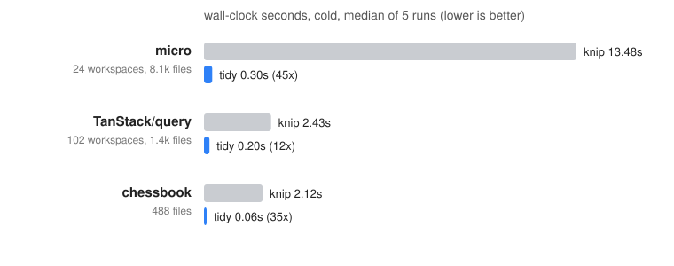

# tidy

[](https://github.com/marcusbuffett/tidy/actions/workflows/ci.yml)

Find unused files, exports, types, enum members, dependencies and binaries in
JavaScript and TypeScript projects. tidy is a drop-in replacement for
[knip](https://knip.dev): it reads the same configuration, emits the same JSON,
and finishes in a fraction of the time.

```
$ cd my-monorepo && tidy
Unused files (2)
apps/web/src/components/OldBanner.tsx
packages/ui/src/stories/Legacy.tsx
Unused exports (1)
formatLegacy  packages/commons/src/format.ts:12:14
Unused devDependencies (1)
@types/lodash  apps/api/package.json
```

## Speed



| Repository | Workspaces | Source files | knip | tidy | Speedup |
| --- | ---: | ---: | ---: | ---: | ---: |
| micro (private monorepo, 1.37M lines) | 24 | 8,142 | 12.98 s | 0.25 s | 52x |
| [TanStack/query](https://github.com/TanStack/query) | 102 | 1,442 | 2.25 s | 0.18 s | 13x |
| chessbook frontend (Solid + Capacitor app) | 4 | 488 | 1.35 s | 0.05 s | 28x |

Median of 5 cold runs on a 16-core Linux desktop, knip 6.32 with `--no-progress`,
no caches. Reproduce with `bench/compare.sh <repo> 5`. Most of tidy's time is
file I/O; parsing scales with core count.

On these repositories tidy and knip report the same issues, with one exception
that is a knip bug (it credits the `expo` package for a binary of the same name
as another package). Where knip's own test suite says they differ, see below.

## Compatibility with knip

tidy is measured against knip's fixture test suite: every `fixtures/*` project
in the knip repository with the issue counts its test asserts.
`bench/knip-conformance.py` runs them all in about five seconds.

| Category | Tests | Passing |
| --- | ---: | ---: |
| exports | 6 | 83% |
| namespaces | 6 | 67% |
| entry files | 25 | 64% |
| ignoreExportsUsedInFile | 16 | 62% |
| re-exports | 21 | 62% |
| workspaces | 38 | 58% |
| dependencies | 32 | 56% |
| imports | 18 | 50% |
| types | 23 | 48% |
| resolution | 33 | 30% |
| plugins (195 tool integrations) | 437 | 34% |
| **all runnable tests** | **721** | **38%** |

The failing tests are almost all of one kind: knip ships a hand-written plugin
per tool that knows which keys of that tool's config file name dependencies or
entry files (babel presets, eslint configs, angular.json, capacitor plugins).
tidy reads every config file the same generic way, so it misses dependencies
that only appear inside such configs and never reports them as unlisted.
Everything knip does with the TypeScript type checker is replaced by syntax
and symbol analysis; the remaining gaps there are listed under *Not supported*.

Semantics that are mirrored exactly: entry and project globs including the
production `!` suffix, workspace detection (npm, pnpm, yarn, bun), `ignore`,
`ignoreFiles`, `ignoreDependencies`/`ignoreBinaries`/`ignoreUnresolved` with
regexes, per-workspace configuration, `includeEntryExports`,
`ignoreExportsUsedInFile`, JSDoc `@public`/`@alias`/`@beta`, `@types/*`
rules, peer dependencies of used packages, package `exports` maps including
wildcards and `dist`→`src` mapping, scripts in package.json and GitHub
workflows, and the entry/config conventions of all 195 knip plugins.

## Why it is fast

knip builds a TypeScript `Program` per workspace and asks the type checker
questions; that is where most of its time goes. tidy never type-checks:

- **oxc** (`oxc_parser` + `oxc_semantic`, the engine behind Vite 8, Rolldown
  and oxlint) parses every file in parallel with rayon. Symbol references from
  the semantic pass give in-file usage, `Enum.Member` access and
  `ns.export` access without a type checker.
- **oxc_resolver** resolves imports with full tsconfig `paths`, `extends`,
  `customConditions` and package `exports` support, one resolver per tsconfig.
- ripgrep's `ignore` crate walks the tree while honouring `.gitignore`.
- Config files (`vite.config.ts`, `next.config.js`, `knip.ts`, `tidy.jsonc`,
  ...) are read statically. Literal strings that name files or globs become
  entry files; no plugin code is ever executed.
- Generated code reached through imports is parsed with a module-record-only
  pass, and multi-megabyte files are scanned for import statements instead.

## Install

```
cargo install --git https://github.com/marcusbuffett/tidy --tag v0.2.1
```

With [mise](https://mise.jdx.dev), pin it per project in `mise.toml`:

```toml
[tools]
"cargo:https://github.com/marcusbuffett/tidy" = "tag:v0.2.1"
```

## Usage

```
tidy [DIR] [--reporter text|json|flat] [--include files,exports,...]
     [--exclude ...] [--production] [--workspace apps/web] [--perf]
     [--explain path/to/file.ts] [--config tidy.json] [--no-exit-code]
```

- `--reporter json` prints knip's JSON shape, so existing tooling keeps working.
- `--explain <file>` shows how a file was classified, how each import resolved,
  which exports are used and by whom. Start here when a result looks wrong.
- `--perf` prints per-phase timings.
- The exit code is 1 when issues are found (`--no-exit-code` to disable).

## Configuration

tidy reads `tidy.json`, `tidy.jsonc`, `tidy.ts`, `knip.json`, `knip.jsonc`,
`knip.ts` or the `knip` key in `package.json`. TypeScript configs are evaluated
statically: the default export must be a literal object (`satisfies
KnipConfig`, `defineConfig({...})`, spreads of local constants and regex
literals all work).

Supported keys: `entry`, `project`, `ignore`, `ignoreFiles`,
`ignoreDependencies`, `ignoreBinaries`, `ignoreUnresolved`,
`ignoreWorkspaces`, `workspaces`, `includeEntryExports`,
`ignoreExportsUsedInFile`, `include`, `exclude`, `rules` (`"off"`), `tags`,
and per-tool overrides (`vitest: false`, `playwright: { config: [...] }`).

## What is detected

| Issue type | Notes |
| --- | --- |
| files | project files not reachable from any entry file |
| exports / types | exports no other file imports (knip semantics: entry files, `@public`, type references inside used type exports, destructured bindings) |
| enumMembers | members never accessed as `Enum.Member` anywhere |
| dependencies / devDependencies | listed but never imported, referenced in config files, scripts or by a used package's peer dependencies |
| unlisted | imported packages missing from this workspace or its ancestors |
| binaries | binaries in package.json scripts not provided by any dependency |
| unresolved | relative/aliased imports that do not resolve |
| classMembers | opt-in via `--include classMembers` (static access only) |

Entry files come from: config `entry`, `package.json` `main`/`module`/`bin`/
`exports` (dist paths are mapped back to `src`), files run by `package.json`
scripts and GitHub workflows, `--config` arguments of tool binaries in scripts,
`<script type="module">` tags in html entries, declaration files included by
tsconfig, and the entry/config conventions of knip's 195 plugins
(`src/tools.rs`, generated from knip's sources by `scripts/gen-tools.py`).

Beyond knip:

- Stylesheets are followed when they are project files (tailwind in the
  dependencies adds `**/*.css` to the default project, as knip's css compiler
  does): `@import`, `@plugin`, `@reference` and `@config` credit packages and
  reach other stylesheets, and `<link rel="stylesheet">` in html entries counts
  as an import. A bare `@import "x.css"` is relative when the sibling exists.
- With `ios/` or `android/` present, every dependency whose `package.json` has
  a `capacitor` section for that platform is used: `cap sync` links it into the
  native project whether or not any code imports it.
- Exports of generated files (a leading comment containing `@generated`, or
  "generated" and "DO NOT EDIT") are never reported; the file itself still is
  when nothing imports it.

## Not supported

- Dependencies that only appear inside tool configuration under tool-specific
  keys (babel presets, eslint plugins, ...) are not credited or reported as
  unlisted; list them in `ignoreDependencies` if tidy flags them.
- `--strict`, `--fix`, `--cache`, tags filtering, `duplicates`, `cycles`,
  `catalog`, `nsExports`/`nsTypes` issue types, custom compilers.
- `classMembers` uses static member access only (knip uses the type checker).
- `.svelte`, `.vue`, `.astro` and `.mdx` files get script-block extraction only;
  CSS preprocessors (`.scss`, `.less`) are not analysed.

## Development

```
cargo build --release
cargo test --release                       # fixture projects under tests/fixtures
bench/compare.sh <repo> 5                  # wall-clock comparison with knip
bench/knip-conformance.py                  # knip's fixture suite (needs ~/.cache/tidy/knip)
scripts/gen-tools.py                       # regenerate src/tools.rs from knip's plugins
```

`bench/knip-conformance.py` expects a knip checkout
(`git clone https://github.com/webpro-nl/knip ~/.cache/tidy/knip`); its
fixtures ship their own `node_modules`, so no install step is needed.

## License

MIT
